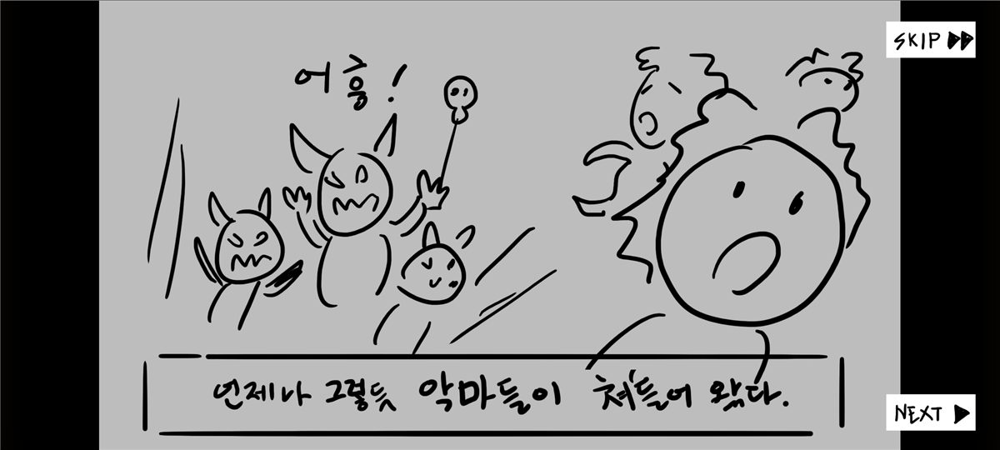
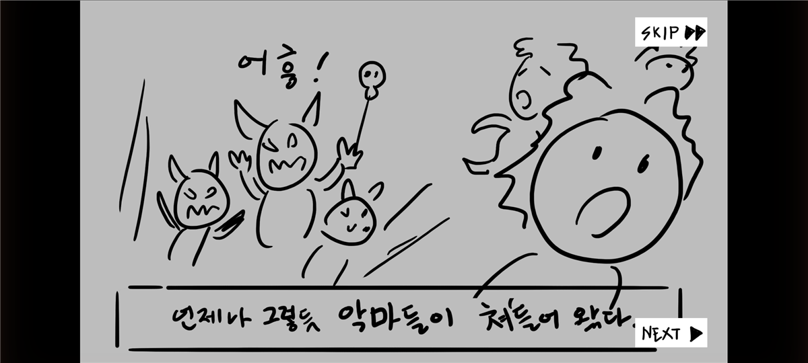
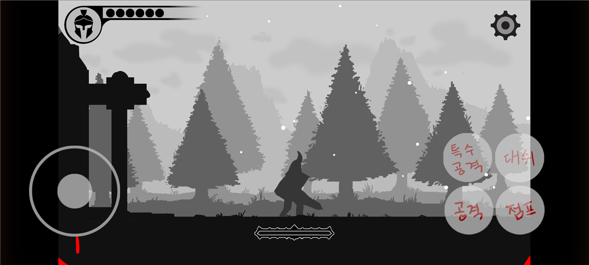
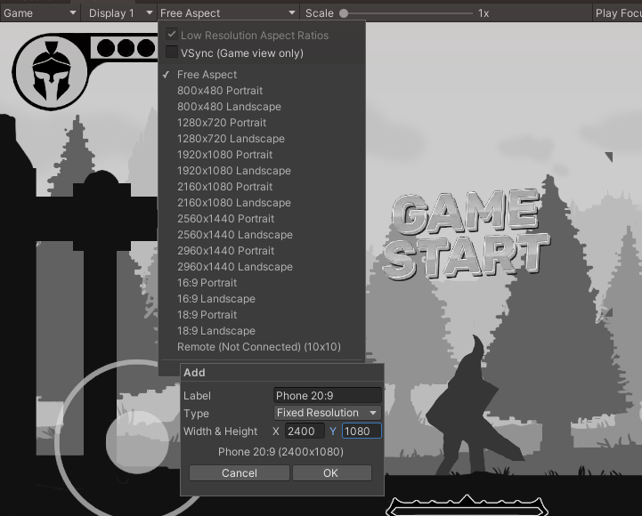

# 10주차 - 모바일 UI 화면 맞춤

**휴대폰에서 빌드를 실행했더니 버튼과 HUD가 그림 밖 검은 여백으로 밀려나 있었다면** 이 문서대로 하세요. 스크립트 파일 하나만 넣으면 됩니다.

> **씬이나 그림은 하나도 고치지 않습니다.** 파일을 넣고 다시 빌드하면 끝입니다.

---

## 1. 무엇이 문제인가

| | PC (16:9 모니터) | 휴대폰 (대부분 16:9보다 가로로 김) |
|---|---|---|
| 게임 화면 | 화면 가득 | 가운데 16:9, **양옆은 검은 여백** |
| HUD · 컷신 버튼 (고치기 전) | 게임 화면 모서리 | **휴대폰 화면 모서리 = 검은 여백 위** |
| HUD · 컷신 버튼 (고친 뒤) | 게임 화면 모서리 (변화 없음) | **게임 화면 모서리** |

- 게임 화면은 어떤 기기에서도 16:9로 고정됩니다. 남는 곳이 검게 보이는 것은 정상입니다
- 그런데 HUD와 버튼은 **휴대폰 화면 전체의 모서리**에 붙어 있어서, 휴대폰에서는 검은 여백 쪽으로 밀려났습니다
- PC 모니터는 16:9라서 차이가 없었고, **휴대폰에서만 드러나는 문제**입니다

**고치기 전** - `SKIP` · `NEXT` 가 그림 밖 검은 여백 위에 있습니다



**고친 뒤** - `SKIP` · `NEXT` 가 그림 안 모서리로 들어왔습니다



**고친 뒤 플레이 화면** - HP 표시와 톱니는 그림 안, 조이스틱과 공격 버튼은 화면 끝 그대로



**고친 뒤에 16:9 안으로 들어오는 것**

- 플레이 화면 HUD - HP 표시, 스페셜 게이지, 톱니(일시정지) 버튼
- 일시정지 메뉴, 설정 · 조작 설명 팝업, 사망 화면, 스테이지 시작 · 클리어 화면
- 타이틀 화면의 버튼과 로고
- 인트로 · 엔딩 컷신의 `PREV` · `NEXT` · `SKIP` 버튼

**그대로 화면 끝에 남는 것 - 모바일 조작 버튼**

- 조이스틱, 공격 · 점프 · 대시 · 특수공격 버튼은 **일부러 휴대폰 화면 끝에 그대로 둡니다**
- 손가락(엄지)이 닿기 편한 자리가 게임 화면이 아니라 **휴대폰의 실제 가장자리**이기 때문입니다. 검은 여백 위에 놓여도 정상입니다

---

## 2. 파일 받기

**[UI 화면 맞춤 파일 내려받기](https://github.com/hansung-game1/game-p-docs/raw/main/%EC%A3%BC%EC%B0%A8%EB%B3%84%EC%88%98%EC%97%85/files/W10_UI_%ED%99%94%EB%A9%B4%EB%A7%9E%EC%B6%A4.zip)** ← 누르면 바로 받아집니다 (약 3KB)

압축을 풀면 **`UiAspectFrame.cs`** 파일 하나가 나옵니다.

---

## 3. 프로젝트에 넣기

**1) Unity에서 `Project` 창의 이 폴더를 엽니다.**

```
Assets/_Project/01_Scripts/UI/
```

**2) `UiAspectFrame.cs` 를 그 폴더 안으로 끌어다 놓습니다.**

- 파일 이름은 **`UiAspectFrame.cs` 그대로** 두세요
- 잠깐 기다리면 Unity가 스크립트를 읽습니다 (오른쪽 아래 동그라미가 돌다가 멈춤)

**3) `Console` 창에 빨간 에러가 없는지 봅니다.**

- 아무것도 안 떠도 정상입니다
- `already contains a definition for 'UiAspectFrame'` 에러가 뜨면 **같은 파일을 두 번 넣은 것**입니다. `Project` 창 위쪽 검색칸에 `UiAspectFrame` 을 쳐서 하나만 남기고 지우세요

> **어디에 붙이거나 메뉴를 실행할 필요가 없습니다.** 게임이 실행될 때 스스로 동작합니다.

---

## 4. 빌드 전에 Unity에서 확인하기

휴대폰이 없어도 **`Game` 창 비율을 휴대폰처럼 바꾸면** 확인할 수 있습니다.

**1) 휴대폰 비율 추가하기 (처음 한 번만)**

1. `Game` 창 위쪽의 **`Free Aspect`** 를 누릅니다
2. 목록 맨 아래 **`+`** 를 누릅니다
3. 이렇게 넣고 **`OK`**

| 칸 | 넣을 값 |
|---|---|
| `Label` | `Phone 20:9` |
| `Type` | `Fixed Resolution` (그대로) |
| `Width & Height` | `X` **2400** · `Y` **1080** |



목록에 `Phone 20:9 (2400x1080)` 이 생기고 선택됩니다.

> 위 그림은 플랫폼이 **Android** 일 때라 목록이 깁니다. **Windows** 일 때는 목록이 짧지만 맨 아래 `+` 는 똑같이 있습니다. Android 상태라면 목록에 이미 있는 **`2160x1080 Landscape`** 를 골라도 됩니다 (이것도 16:9보다 가로로 긴 휴대폰 비율입니다). Windows와 Android는 이 목록을 따로 저장하므로, 플랫폼을 바꾸면 `Phone 20:9` 를 다시 추가해야 할 수 있습니다.

**2) Play 해서 봅니다.**

- [ ] 플레이 화면 - HP 표시와 톱니가 **게임 그림 안** 모서리에 있다
- [ ] 조이스틱과 공격 버튼은 **화면 끝(검은 여백 쪽)** 에 그대로 있다
- [ ] 인트로 · 엔딩 컷신 - `NEXT` · `SKIP` 이 **그림 안**에 있다
- [ ] 톱니를 눌러 일시정지 메뉴와 설정 창이 잘 열린다

> ★ **Play를 누르기 전(편집 화면)에는 예전처럼 버튼이 검은 여백 위에 보입니다. 정상입니다.** 실행할 때만 안으로 들어옵니다.

**3) 확인이 끝나면 `Game` 창을 다시 `16:9` 또는 `Free Aspect` 로 돌려 놓습니다.** 평소 작업은 지금까지 하던 대로 하면 됩니다.

---

## 5. 다시 빌드하고 올리기

1. **Android(모바일) 빌드를 다시 합니다.** 순서는 [W10 1차 빌드](<W10_1차_빌드(PC,모바일).md>) 의 「4. Android(모바일) 빌드 만들기」와 같습니다. 두 번째 빌드부터는 처음보다 훨씬 빠릅니다
2. 휴대폰에 설치해서 버튼이 그림 안으로 들어왔는지 확인합니다
3. **PC 빌드는 다시 하지 않아도 됩니다.** PC(16:9)에서는 달라지는 것이 없습니다
4. **GitHub Desktop** 에 `UiAspectFrame.cs` 와 `UiAspectFrame.cs.meta` 두 개가 뜹니다. 커밋하고 `Push` 하세요

---

## 관련 문서

- [W10 1차 빌드 (PC·모바일)](<W10_1차_빌드(PC,모바일).md>)
- [W11 모바일 UI · 사운드](W11_모바일UI_사운드.md) - 모바일 조작 버튼 그림 만들기
- [자주 나오는 문제 16번](<../기본설명/08_자주_나오는_문제.md#16-play하면-톱니일시정지-버튼이-안-보입니다---검은-띠-위의-검은-그림입니다>) - 검은 띠 위의 어두운 그림
