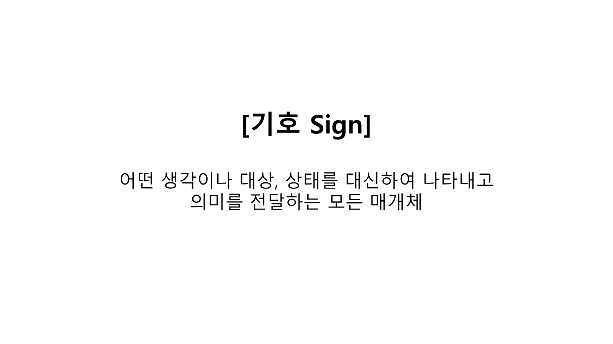
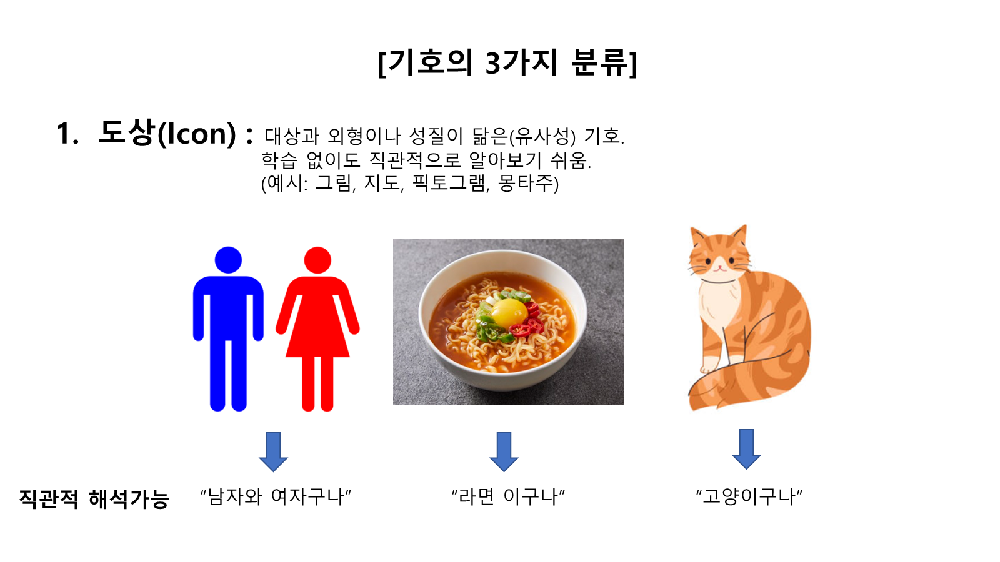
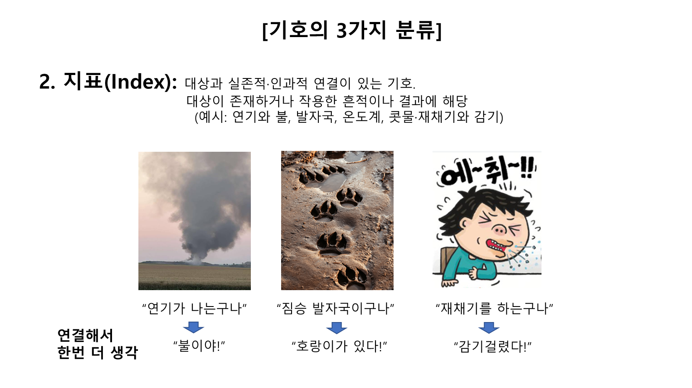
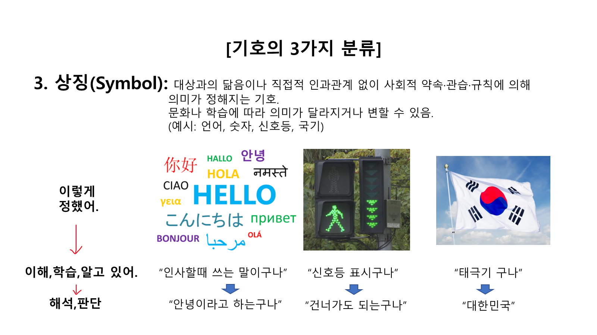
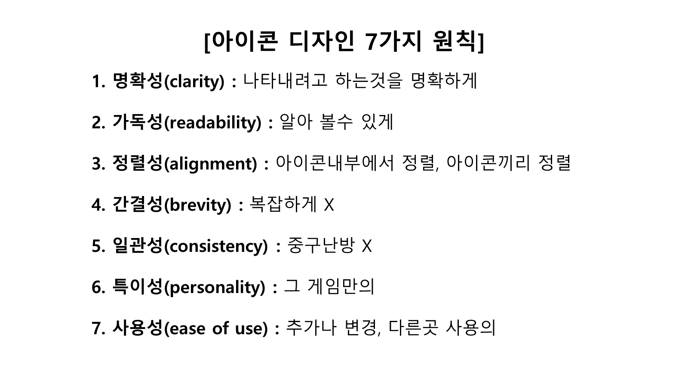
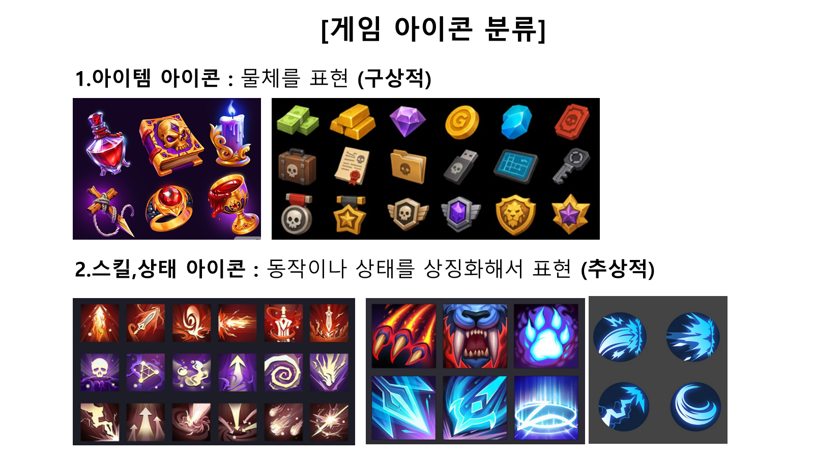
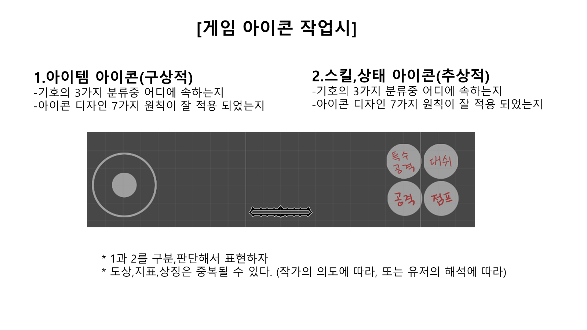

# 11주차 - 모바일 UI 아이콘 디자인

**모바일 버튼 4개(점프 · 공격 · 대시 · 필살기)에 들어가는 아이콘을 어떻게 그릴지 정리한 문서입니다.**

버튼을 만드는 방법(크기 · 파일 이름 · Unity 적용)은 [W11 모바일 UI + 사운드](W11_모바일UI_사운드.md)에 있습니다. 이 문서는 **버튼 안에 무엇을 그릴지**만 다룹니다.

> **왜 따로 보나요?** 제출된 버튼 중에 **무엇을 누르는 버튼인지 알아보기 어려운 것**이 꽤 있었습니다. 그린 사람은 알지만 처음 보는 사람은 모르는 그림, 네 개가 서로 비슷해서 헷갈리는 그림 같은 경우입니다. 아이콘은 **보는 사람이 바로 알아봐야** 의미가 있습니다.

---

## 1. 기호(Sign)란

**아이콘도 기호입니다.** 「점프」라는 동작을 글로 쓰는 대신 그림 하나로 대신 나타내는 것입니다. 그래서 아이콘을 그리기 전에 **기호가 의미를 전달하는 방식 3가지**를 먼저 봅니다.

---

## 2. 기호의 3가지 분류

### 2-1. 도상(Icon) - 닮아서 안다

- 대상과 **모양이 닮은** 기호입니다. 배우지 않아도 바로 알아봅니다
- 보는 사람의 생각이 **한 번에** 끝납니다 → 「고양이구나」

### 2-2. 지표(Index) - 흔적을 보고 안다

- 대상이 **있었거나 작용한 흔적 · 결과**를 보여 주는 기호입니다
- 보는 사람이 **한 번 더 연결해서** 알아냅니다 → 「연기가 나는구나」 → 「불이야!」

### 2-3. 상징(Symbol) - 약속이라서 안다

- 닮지도 않았고 흔적도 아닌데, **사람들끼리 그렇게 정해서** 의미가 생긴 기호입니다
- **약속을 아는 사람만** 알아봅니다. 문화나 학습에 따라 달라질 수 있습니다

### 세 가지 비교

| | 도상 | 지표 | 상징 |
|---|---|---|---|
| 어떻게 아나 | **닮아서** | **흔적 · 결과를 보고** | **약속이라서** |
| 보는 사람이 하는 일 | 바로 앎 | 한 번 더 연결 | 알고 있어야 함 |
| 예 | 고양이 그림 | 발자국 → 호랑이 | 태극기 → 대한민국 |

---

## 3. 아이콘 디자인 7가지 원칙

| 원칙 | 뜻 | 모바일 버튼에서는 |
|---|---|---|
| 1. 명확성 | 나타내려는 것을 명확하게 | **버튼 하나에 뜻 하나.** 점프 버튼은 점프만 떠오르게 |
| 2. 가독성 | 알아볼 수 있게 | 폰에서는 **손가락 한 마디 크기**로 보입니다. 작게 줄여도 보여야 함 |
| 3. 정렬성 | 아이콘 안에서 정렬, 아이콘끼리 정렬 | 그림이 버튼 **가운데**에 오게. 네 버튼의 그림 크기 · 위치가 비슷하게 |
| 4. 간결성 | 복잡하게 X | 선 · 장식을 줄이고 **실루엣으로도 알아보게** |
| 5. 일관성 | 중구난방 X | 네 버튼의 **선 굵기 · 색 · 그리는 방식이 같게.** normal과 pressed도 같은 그림 |
| 6. 특이성 | 그 게임만의 | 공격 버튼에 **내 캐릭터의 무기**를 넣는 식으로 게임 분위기를 살림 |
| 7. 사용성 | 추가 · 변경 · 다른 곳에 쓰기 쉽게 | 나중에 버튼이 늘어나도 **같은 규칙으로 하나 더 그릴 수 있게** |

---

## 4. 게임 아이콘의 두 종류

| | 1. 아이템 아이콘 | 2. 스킬 · 상태 아이콘 |
|---|---|---|
| 표현하는 것 | **물체** | **동작 · 상태** |
| 표현 방식 | **구상적** - 물체를 그대로 그림 | **추상적** - 동작을 상징화해서 그림 |
| 예 | 물약, 열쇠, 금화, 보석 | 베기, 회오리, 번개, 발톱 자국 |

**우리가 만드는 모바일 버튼 4개는 전부 「동작」입니다.** 점프 · 공격 · 대시 · 필살기 - 모두 2번 **스킬 · 상태 아이콘** 쪽에 가깝습니다. 「동작」은 눈에 보이는 물체가 아니라서 그대로 그릴 수가 없고, **어떻게 상징화할지를 정해야** 합니다. 여기서 모호한 그림이 많이 나왔습니다.

---

## 5. 게임 아이콘 작업할 때

**아이콘 하나를 그릴 때마다 두 가지를 스스로 확인합니다.**

1. **기호의 3가지 분류 중 어디에 속하는지** - 도상으로 그렸나, 지표로 그렸나, 상징으로 그렸나
2. **아이콘 디자인 7가지 원칙이 잘 적용되었는지**

- 먼저 **아이템(구상적)인지, 스킬 · 상태(추상적)인지 구분**하고 표현합니다
- 도상 · 지표 · 상징은 **겹칠 수 있습니다.** 작가의 의도에 따라, 또 보는 사람의 해석에 따라 달라집니다

위 그림 오른쪽 아래의 **「특수공격 · 대시 · 공격 · 점프」 글자 버튼이 지금 템플릿에 들어 있는 임시 그림**입니다. 이 네 개를 **글자 없이 그림만으로** 알아보게 바꾸는 것이 이번 작업입니다.

---

## 6. 우리 버튼 4개에 적용해 보기

**정답이 아니라 생각하는 방법의 예시입니다.** 같은 버튼도 도상 · 지표 · 상징 어느 쪽으로든 그릴 수 있습니다.

| 버튼 | 도상으로 그리면 (닮게) | 지표로 그리면 (흔적 · 결과) | 상징으로 그리면 (약속) |
|---|---|---|---|
| **점프** | 위로 뛰어오르는 캐릭터 실루엣 | 발밑의 먼지 · 아래로 남는 잔상선 | **위쪽 화살표** |
| **공격** | **내 캐릭터의 무기**(검 · 주먹 · 지팡이) | 베고 지나간 **궤적 · 베인 자국** | 교차한 두 검 |
| **대시** | 앞으로 몸을 숙인 캐릭터 | 뒤로 길게 남는 **속도선 · 잔상** | **겹친 화살표(»)** |
| **필살기** | 무기가 빛나는 모습 | 터진 자리 · 큰 충격파 | 별 · 번개 같은 **강조 표시** |

### 이렇게 확인하세요

- **글자를 넣지 않습니다.** 「점프」라고 쓰면 아이콘이 아니라 이름표입니다. 그림만으로 알아봐야 합니다
- **공격과 필살기를 구분하세요.** 둘 다 공격이라서 비슷해지기 쉽습니다. **같은 무기를 쓰되 필살기는 더 크게 · 빛나게** 하는 식으로 「같은 계열인데 더 강하다」가 보이게 합니다 (일관성 + 명확성)
- **점프와 대시를 구분하세요.** 둘 다 화살표로 그리면 방향만 다르고 헷갈립니다. **위로 vs 앞으로**가 한눈에 갈려야 합니다
- **작게 줄여서 보세요.** 그린 그림을 **엄지손톱 크기**로 줄여 봐도 무엇인지 알 수 있어야 합니다. 폰에서는 그 크기로 보입니다
- **흑백 실루엣으로 보세요.** 색을 빼도 네 개가 서로 구분되면 모양이 잘 잡힌 것입니다
- **처음 보는 사람에게 물어보세요.** 옆 사람에게 버튼만 보여 주고 「이거 뭐 하는 버튼 같아?」라고 물어서 **바로 맞히면 성공**입니다. 설명을 들어야 안다면 모호한 것입니다
- **네 개를 나란히 놓고 보세요.** 선 굵기 · 색 · 그림 크기가 제각각이면 일관성이 깨진 것입니다

> [!CAUTION]
> **normal과 pressed는 같은 그림입니다.** pressed에서 아이콘 모양을 바꾸지 말고 **밝기 · 색 · 크기만** 바꿉니다. 그림이 바뀌면 누를 때마다 다른 버튼처럼 보입니다.

---

## 다음 단계

아이콘을 정했으면 [W11 모바일 UI + 사운드](W11_모바일UI_사운드.md)의 **A-2 리소스 제작 규격**대로 버튼 8장(4종 × normal · pressed)을 만들어 넣으세요.
